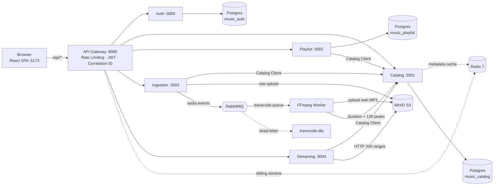

# Distributed Multimedia Streaming Platform

A production-grade, distributed music streaming and audio processing platform built with an event-driven microservices architecture. Designed to decouple lightweight API metadata handling from compute-intensive audio transcoding and high-throughput byte-range media delivery.

---

## Core Engineering Highlights

- **Event-Driven Multimedia Ingestion**: Decouples audio uploads from heavy transcoding via RabbitMQ, containerized FFmpeg workers, and dead-letter queues (DLQ).
- **Sub-10ms Byte-Range Streaming**: Low-latency partial content delivery (`HTTP 206`) from MinIO S3 object storage honoring RFC 7233 range requests.
- **Persistent Client-Side Audio Shell**: React 19 Single Page Application (SPA) with an unbroken root audio context and dynamic 128-point waveform visualization across page navigation.
- **Edge Security & Rate Limiting**: Centralized API Gateway enforcing JWT token verification, guest vs. member role rules, and Redis-backed sliding-window rate limiting.
- **Automated Test Rigor**: 200+ unit and integration tests across 9 workspace packages testing contracts, byte-range parsing, and queue mechanics.

---

## System Architecture



---

## 60-Second Quickstart

Launch the complete ecosystem with turnkey sample music, pre-computed waveforms, and playable audio:

```bash
# 1. Install workspace dependencies
pnpm install

# 2. Start PostgreSQL, Redis, RabbitMQ, and MinIO in Docker
pnpm docker:up

# 3. Build workspace packages and seed demo library (12 tracks + audio blobs)
pnpm build
pnpm seed

# 4. Start all microservices, API Gateway, and React frontend
pnpm dev
```

Open **http://localhost:5173** in your browser. Play free tracks instantly, create an account, upload custom audio, and build playlists.

---

## Documentation Index

Detailed specifications, runbooks, and benchmarks are split into focused guides:

| Document | Description |
| :--- | :--- |
| **[Product Requirements & Overview](docs/description.md)** | Problem statement, functional requirements, and system design objectives. |
| **[System Architecture & Design](docs/architecture.md)** | Microservice boundaries, detailed sequence diagrams, and security mechanics. |
| **[Setup & Runbook Guide](docs/setup-and-run.md)** | Step-by-step installation, environment variables, migrations, and service startup. |
| **[API Reference Catalog](docs/api-reference.md)** | Complete endpoint specifications, payload schemas, and error code tables. |
| **[Verification & Benchmarks](docs/verification.md)** | Automated testing suites, manual cURL smoke tests, and latency measurements. |

---

## Repository Structure

```
├── docs/               # Modular architecture, API, setup, and verification guides
├── frontend/           # React 19 + Vite + Tailwind CSS Single Page Application
├── gateway/            # Express reverse proxy, JWT verification, and Redis rate limiting
├── scripts/            # Database initialization and latency/transcode benchmarks
├── services/           # Backend microservices (Auth, Catalog, Playlist, Ingestion, Streaming, Worker)
├── shared/             # Monorepo shared package (@music/shared) with models, DTOs & clients
├── docker-compose.yml  # Multi-container orchestration (Postgres, Redis, RabbitMQ, MinIO)
└── pnpm-workspace.yaml # Monorepo workspace configuration
```

---

## Stopping Infrastructure

```bash
pnpm docker:down         # Stop containers and retain database volumes
docker compose down -v   # Stop containers and wipe all persistent data
```
