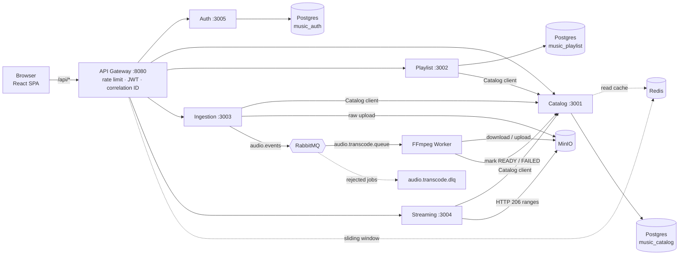
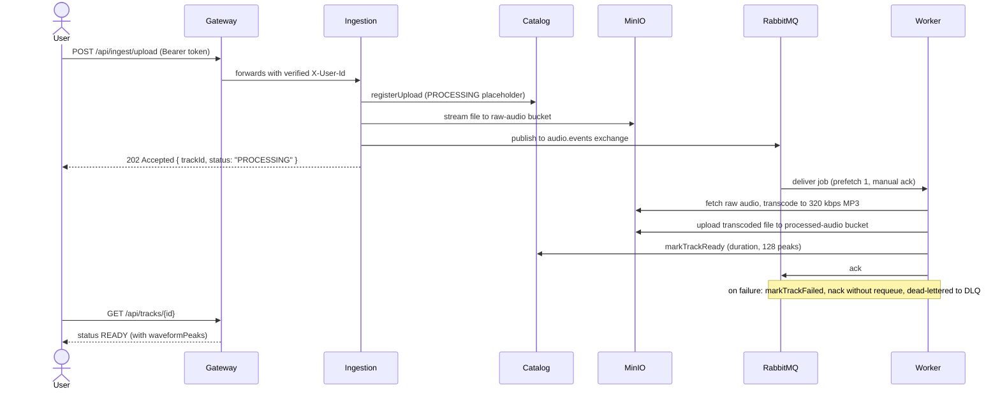
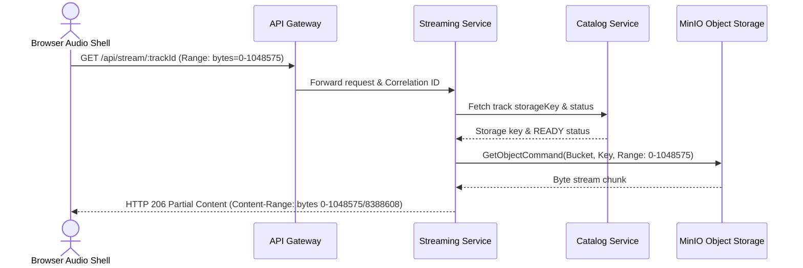

[← Back to README](../README.md) · **[Overview](description.md)** · **[Architecture](architecture.md)** · **[Setup & Run](setup-and-run.md)** · **[API Reference](api-reference.md)** · **[Verification](verification.md)**

---

# System Architecture & Technical Design

This document details the distributed systems architecture, microservices boundaries, data flows, and security mechanics of the Distributed Multimedia Streaming Platform.

---

## 1. System Topology & Flowchart

Every external client request enters through the **API Gateway** on port `8080`. Upstream microservices never expose their private ports to the public internet, and communicate across isolated network boundaries. The only asynchronous cross-service path is mediated via **RabbitMQ**.

---

## 2. Microservice Responsibilities & Service Map

| Service / Component | Port | Persistence | Primary Responsibility |
| :--- | :---: | :--- | :--- |
| **API Gateway** | `8080` | In-memory / Redis | Ingress reverse proxy, JWT verification, Redis sliding-window rate limiting, `X-Correlation-ID` generation & health aggregation. |
| **Auth Service** | `3005` | PostgreSQL (`music_auth`) | User registration, bcrypt credential verification, and JWT session token generation. |
| **Catalog Service** | `3001` | PostgreSQL (`music_catalog`) + Redis | Relational metadata store for artists, albums, tracks, and genres with sub-millisecond Redis caching. |
| **Playlist Service** | `3002` | PostgreSQL (`music_playlist`) | Custom playlists, strict track ordering, and user favorites. Relies on Catalog Service for track metadata. |
| **Ingestion Service** | `3003` | MinIO (`raw-audio`) + RabbitMQ | Validates incoming audio MIME types, streams raw uploads to MinIO, registers `PROCESSING` placeholder, dispatches queue job. |
| **Transcode Worker** | *Containerized* | MinIO (`processed-audio`) + Scratch disk | Asynchronous background worker using FFmpeg to transcode audio to 320 kbps MP3, compute 128 normalized amplitude peaks, and trigger DLQ on failure. |
| **Streaming Service** | `3004` | MinIO (`processed-audio`) | Low-latency HTTP 206 Partial Content server honoring RFC 7233 byte-range slicing. |
| **React Frontend** | `5173` | LocalStorage / Context | React 19 + Vite SPA featuring a persistent root audio context that preserves media playback across page transitions. |
| **Shared Package** | N/A | Monorepo internal | `@music/shared` containing DTOs, domain models, Range parser, Zod schemas, Catalog HTTP client, and JWT utilities. |

---

## 3. End-to-End Sequence Diagrams

### 3.1. Asynchronous Upload & Transcoding Pipeline

### 3.2. Low-Latency HTTP 206 Byte-Range Streaming

---

## 4. Security & Ingress Model

### 4.1. Gateway Perimeter & Token Verification
- The API Gateway is the **sole entry point** for all clients.
- Downstream microservices (`:3001` - `:3005`) run in private network space and trust headers forwarded by the gateway.
- The gateway intercepts incoming `Authorization: Bearer <token>` headers, validates the HMAC-SHA256 signature, extracts `userId` and `email`, strips any spoofed `X-User-Id` sent by the client, and injects verified `X-User-Id` downstream.

### 4.2. Role-Based Permissions (Guest vs. Member)

| Resource / Capability | Guest (No Token) | Authenticated Member | Enforced By |
| :--- | :---: | :---: | :--- |
| Browse & search catalog | Allowed | Allowed | Gateway / Catalog |
| View album / artist profiles | Allowed | Allowed | Gateway / Catalog |
| Stream **free** tracks | Allowed | Allowed | Streaming Service |
| Stream **premium** tracks | `401 LOGIN_REQUIRED` | Allowed | Streaming Service |
| Create / manage playlists | `401 LOGIN_REQUIRED` | Allowed | Gateway / Playlist |
| Toggle track favorites | `401 LOGIN_REQUIRED` | Allowed | Gateway / Playlist |
| Upload raw audio files | `401 LOGIN_REQUIRED` | Allowed | Gateway / Ingestion |

---

## 5. Persistence & Storage Architecture

1. **Logical Database Isolation (PostgreSQL 16)**:
   - `music_catalog`: Artists, Albums, Tracks, and Genres.
   - `music_playlist`: Playlists, PlaylistTracks (ordered index), and User Favorites.
   - `music_auth`: Users, hashed passwords, and profile credentials.
2. **Distributed In-Memory Cache (Redis 7)**:
   - Sliding-window rate limiting counters (`ratelimit:<ip>`).
   - Catalog queries cache with automatic cache eviction on mutations.
3. **Object Storage Buckets (MinIO S3)**:
   - `raw-audio`: Uncompressed master files (WAV, FLAC, MP3, AAC). Private bucket.
   - `processed-audio`: Web-ready 320 kbps MP3 files. Delivered via byte-range server.
